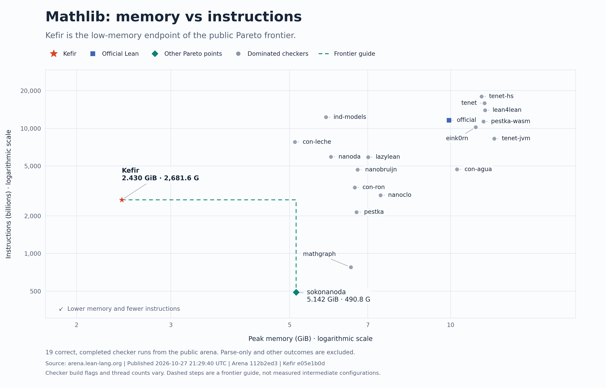
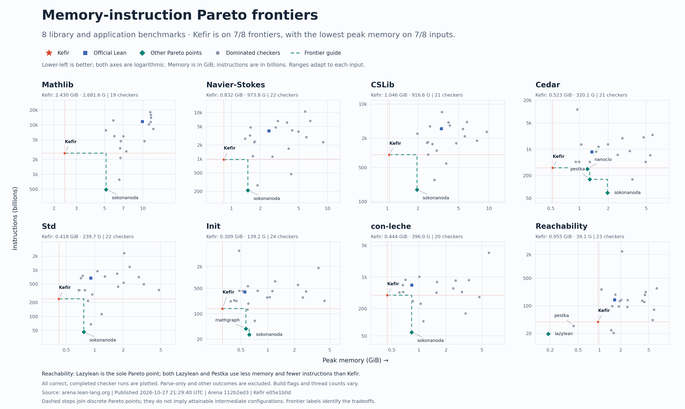

# kefir

**K**ernel **E**nforcing **F**ormal **I**nference **R**ules: an independent
external proof checker for Lean 4.

kefir checks Lean developments without trusting Lean's own kernel, and aims to do
it with as little memory and as few instructions as possible. It reads
declarations exported by [lean4export](https://github.com/leanprover/lean4export)
(format 3.1.0) and checks every type and proof itself, including inductive types
and their recursors, which it re-derives rather than taking from the export.



On the [Lean Kernel Arena](https://arena.lean-lang.org) snapshot of 2026-10-27
(arena `112b2ed3`, kefir `e05e1b0`), kefir has the lowest peak memory of any checker
on all seven library inputs, and is on the memory–instruction Pareto frontier for
each of them. On Reachability, a smaller application input, lazylean and pestka use
both less memory and fewer instructions. kefir is not the fastest: on Mathlib,
sokonanoda and mathgraph execute about 5.5× and 3.5× fewer instructions, with 2.1×
and 2.7× kefir's peak memory.



Acceptance is relative to the axioms the report lists. It does not establish that
a theorem states the intended claim or that its assumptions are justified.

## What it does differently

kefir checks the same type theory as Lean's kernel and aims to accept and
reject the same declarations. The differences are in what it trusts, what its
answers mean, and how it computes.

### What it trusts

- **Recursors are rebuilt, not read.** Lean's kernel generates an inductive
  type's recursor and computation rules itself; an export contains them as
  data. kefir generates them from the inductive declaration, then requires the
  exported recursor type, every computation rule, the parameter, index, motive
  and minor-premise counts and the K-like flag to match what it generated. A
  mismatch rejects: an export whose rule for `PUnit.unit` returns the wrong
  term is rejected even though every declaration in it is well typed.
- **Declarations must be closed.** A declaration type or body, inductive type
  or constructor type that contains a bound variable no binder binds, or a
  universe parameter the declaration does not list, is rejected. The first
  check reads a summary kefir records on every term as it builds it, so it
  costs one lookup per declaration; the second is one walk over the term.
- **Native arithmetic is earned.** Nat and String literals are computed
  natively only after the prelude definitions they stand for have been checked
  and found to have their expected form.
- **Native-computation axioms are refused by default.** Reaching an axiom
  with a `_native` name component ends the run in decline unless the run allows
  all declared axioms (see [Axiom policy](#axiom-policy)).

### What its answers mean

- **Decline is a verdict of its own.** An unsupported construct, an exhausted
  work or storage budget, or a computation kefir abandons ends in decline, never
  in reject. Budgets are charged the same way in every build, so a given input
  always gets the same verdict.
- **Rejections come from named rules.** Failing to show two terms equal proves
  nothing. kefir rejects only when a specific rule establishes a difference:
  two universes that compare unequal, a Sort against a function type, two
  distinct constructors, two different axioms or local variables in head
  position, a wrong exported recursor, a duplicate name. A comparison that
  fails in any other way declines.
- **Equalities are not chained.** Lean's kernel joins proven equalities into
  classes, so a = b and b = c answer a = c without a check. kefir compares a
  and c itself, because chaining makes an incomplete procedure's answers
  depend on the order of comparisons. Measured on the library inputs,
  chaining would change instructions by about 1% either way.

### How it computes

- **An evaluator does most of the work.** Instead of substituting arguments
  into terms, kefir evaluates a term together with an environment of values,
  unfolds a definition only when its value is needed, and reuses the result of
  evaluating the same term in the same environment. This evaluator only ever
  confirms; when it cannot finish, the declaration is re-checked by a separate
  substitution-based checker, which can also reject.
- **Variables under binders are reused.** Going under a binder, the evaluator
  names the new variable by its type and binder depth, so the same binder met
  again yields the same variable and the work done under it is found again.
- **Proof arguments are not compared.** When two applications of the same
  function are compared, an argument whose type is a proposition is skipped,
  since any two proofs of a proposition are equal. Which arguments are proofs
  is read once from the function's type and cached.
- **Structures are split before they are reduced.** A recursor applied to a
  value of a single-constructor structure can fire on that value's projections
  without first reducing the value.
- **Hot definitions get derived rules.** When one definition has been unfolded
  32 times while checking a declaration, kefir derives rules from its body of
  the form "if these arguments are these constructors, the call is this field,
  this argument or this recursive call", and applies them instead of unfolding
  while they match. Nothing is keyed by name.
- **Work carries over between declarations, within 16 MiB.** Lean's kernel
  starts each declaration with empty caches. kefir keeps up to 16 MiB of
  evaluator state from one declaration to the next, and recognizes a theorem
  whose statement and proof repeat one already checked.
- **Caches are small and forgetful.** Most caches are fixed-size tables of at
  most 2¹⁹ slots that overwrite on collision, so a large input pays memory only
  where kefir must remember exactly. Every cache states which results it holds
  and where they remain valid.
- **Input streams through.** Each declaration is checked as soon as its record
  is read, and the storage for its own terms is released once it is checked,
  so the export is never held in memory whole.

## Build and run

Input is lean4export NDJSON, format 3.1.0. Requires Rust 1.95.0 or newer. Under
rustup, `rust-toolchain.toml` selects 1.95.0, the version kefir is tested and measured
with; the JSON report's build identity records the compiler actually used. Then:

```sh
cargo build --release --locked
IN=path/to/export.ndjson ./target/release/kefir
```

For a build tuned to the machine it runs on, as in the Lean Kernel Arena entry, use
`RUSTFLAGS="-C target-cpu=native" cargo build --release --locked`. Native code
generation changes no outcome or resource accounting.

The CLI reads the file named by `IN` and writes its JSON report to stdout.
It does not elaborate Lean source or run tactics. The same checker is available
in process through `Run::new(false).check(reader, writer)`.

| Exit | Outcome |
| --- | --- |
| 0 | Accept: the complete supported input checked successfully |
| 1 | Reject: an implemented check established invalidity |
| 2 | Decline: support, policy or resource limits prevented accepting or rejecting |
| 3 | Input error or internal failure, distinguished by the report's diagnostic code |

### Axiom policy

By default, kefir excludes axioms whose names contain an exact `_native`
component. To admit all declared axioms explicitly:

```sh
IN=path/to/export.ndjson ./target/release/kefir \
  --axiom-policy=allow-all-declared-axioms
```

Admitted axioms still have their types checked and appear in the acceptance
report, including `sorryAx`. This option does not verify native computations.
Keep the selected policy with the command or run configuration; the report alone
does not identify the policy.

## Resource limits

Resource budgets are part of checking and are fixed in this release. Exhausting a budget
declines; it never accepts or rejects.

- **Stack:** checking runs on one thread with a 2 GiB stack reservation. This is address
  space, used only as deep recursion needs it. The evaluator tracks its own stack use and
  gives up an attempt before the end of the reservation.
- **Storage:** up to 16 GiB of managed live storage, plus fixed limits on input size,
  record size, nesting depth and charged work.
- **Measured peak memory** on the Lean Kernel Arena libraries: 2.43 GiB on Mathlib,
  at most 1.05 GiB on the others.

Overflow checks stay enabled in release builds.

## License

Licensed under the Apache License, Version 2.0. See LICENSE. Third-party notices do not specify the license of kefir itself.
