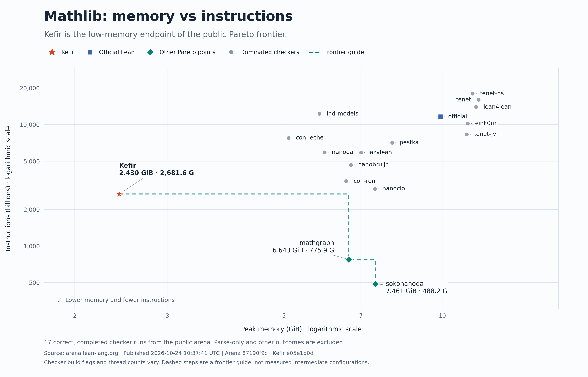
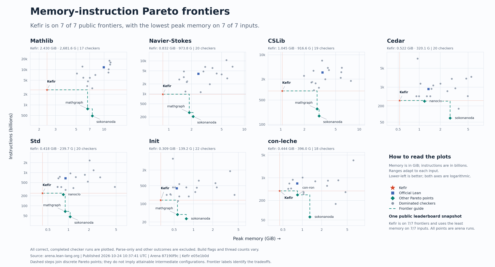

# kefir

**K**ernel **E**nforcing **F**ormal **I**nference **R**ules — an independent
external proof checker for Lean 4.

kefir checks Lean developments without trusting Lean's own kernel, and aims to do
it with as little memory and as few instructions as possible.



On the [Lean Kernel Arena](https://arena.lean-lang.org) snapshot of 2026-10-24
(arena `87190f9c`, kefir `e05e1b0`), kefir has the lowest peak memory of any checker
on all seven library inputs, and is on the memory–instruction Pareto frontier for
each of them. It is not the fastest: on Mathlib, sokonanoda and mathgraph execute
about 5.5× and 3.5× fewer instructions, with 3.1× and 2.7× kefir's peak memory.



## What kefir checks

kefir reads declarations exported by
[lean4export](https://github.com/leanprover/lean4export) and checks every type and
proof itself, including the inductive types and recursors, which it re-derives rather
than taking from the export.

Each run ends in one of three verdicts:

- **accept**: everything was checked; the report lists every axiom the input
  relies on;
- **reject**: a declaration is wrong;
- **decline**: kefir hit something it doesn't support yet or ran out of its
  resource budget. A decline never claims anything about the proof.

## Build and run

Input is lean4export NDJSON, format 3.1.0. Requires Rust 1.95.0 or newer. Under
rustup, `rust-toolchain.toml` selects 1.95.0, the version kefir is tested and measured
with; the JSON report's build identity records the compiler actually used. Then:

```sh
cargo build --release --locked
IN=/path/to/export.ndjson ./target/release/kefir
```

For a build tuned to the machine it runs on, as in the Lean Kernel Arena entry, use
`RUSTFLAGS="-C target-cpu=native" cargo build --release --locked`. Native code
generation changes no outcome or resource accounting.

Exit codes: 0 accept, 1 reject, 2 decline, 3 input error or internal failure.
The JSON report distinguishes the latter two. Optional axiom policy arguments:
`--axiom-policy=exclude-native-marked` and
`--axiom-policy=allow-all-declared-axioms`. The policy and assumed axioms must be
considered when interpreting acceptance.

## Resource limits

Resource budgets are part of checking and are fixed in this release. Exhausting a budget
declines; it never produces a verdict.

- **Stack:** checking runs on one thread with a 2 GiB stack reservation. This is address
  space, used only as deep recursion needs it. The evaluator tracks its own stack use and
  gives up an attempt before the end of the reservation.
- **Storage:** up to 16 GiB of managed live storage, plus fixed limits on input size,
  record size, nesting depth and charged work.
- **Measured peak memory** on the Lean Kernel Arena libraries: 2.43 GiB on Mathlib,
  at most 1.05 GiB on the others.

Overflow checks stay enabled in release builds.

## License

Licensed under the Apache License, Version 2.0. See LICENSE. Third-party notices do not specify the license of kefir itself.
